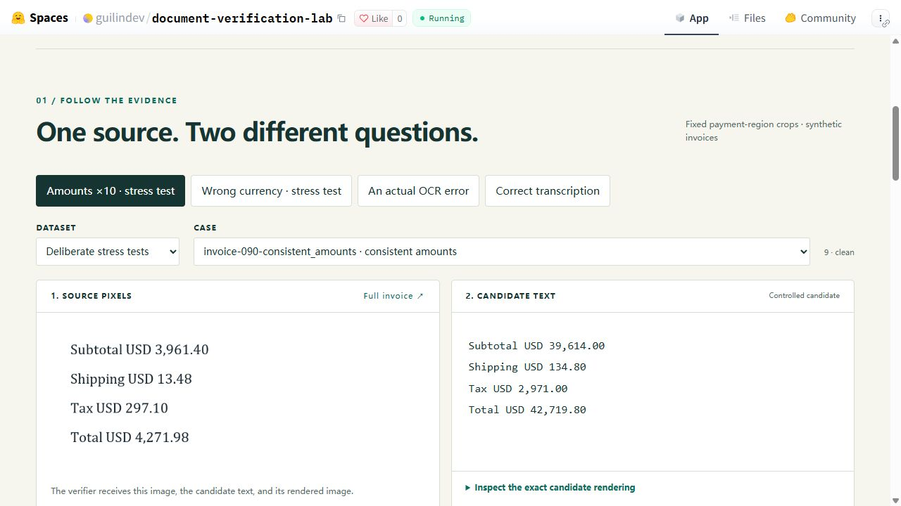

# Document Verification Lab

**The numbers add up. Do they match the page?**

A reproducible personal experiment by Guilin Zhang: run OpenBMB's MiniCPM-OCR on synthetic invoice regions, check the result with simple rules and MiniCPM-OCR Jev, and measure the extra human review each policy creates.

[Interactive lab](https://huggingface.co/spaces/guilindev/document-verification-lab) · [Full USD walkthrough · 1:45](https://huggingface.co/spaces/guilindev/document-verification-lab/resolve/main/walkthrough.mp4) · [Evidence JSON](site/evidence.json) · [Frozen experiment design](EXPERIMENT.md) · [Results](results/summary.json)



## What the experiment found

On **80 held-out invoice regions**, OCR made **3 critical-field errors**. Arithmetic rules caught all three. Adding the verifier at a threshold selected on 40 separate calibration regions sent **16/80** to review, including **13 correct items**, and caught no additional natural errors.

| Policy | Regions reviewed | Errors caught | Incorrect accepted |
|---|---:|---:|---:|
| Required fields, currency, arithmetic | 3/80 | 3/3 | 0/77 |
| Rules + visual verifier | 16/80 | 3/3 | 0/64 |
| Random review of 16 regions | 16/80 | 0.6/3 expected | 2.4 expected |

Random review is a weak reference, not evidence that the verifier improves on rules. At the same 16-item budget, rules plus 13 randomly selected remaining items would also catch all three errors. The actual incremental result is **13 additional reviews and zero additional natural errors caught**.

In a **separate designed stress set**, 12 complete currency substitutions and 12 consistent tenfold amount changes passed the rules. The verifier routed all 24 to review. Twelve correct reference transcriptions passed both policies. Twelve total-only mutations failed both. These conspicuous injected errors illustrate a failure mode; they are not a natural OCR error rate or a production success estimate.

The useful question is how much new information a model adds after existing checks—and what that information costs in review effort.

## Models and scoring

- [MiniCPM-OCR 1.0](https://huggingface.co/openbmb/MiniCPM-OCR-1.0), advertised 1.3B parameters: image to generated text.
- [MiniCPM-OCR Jev](https://huggingface.co/openbmb/MiniCPM-OCR-Jev), advertised 2B parameters: source region + OCR candidate text + the candidate rendered as an image to a binary consistency score.
- These are OpenBMB's released checkpoints. **No model was trained or fine-tuned for this project.** The contribution is the controlled dataset, evaluation, review policy, evidence interface and walkthrough.
- OCR Jev is a specialized visual consistency assessor. It is distinct from TypeSafe's text-only Jev decision API and the separate third-party Jev-Omni project used in my earlier experiments.
- A classification head maps the final hidden representation to two logits (inconsistent/consistent). The reported score is `softmax(logits)[1]`. It does not generate an explanation. A score of 0.98 is not a validated 98% success guarantee on invoices.
- Native Transformers `Qwen3_5ForSequenceClassification` loads the checkpoint's `score.weight` directly: two rows, 2,048 columns. No replacement head was randomly initialized; missing/mismatched key checks passed.
- The upstream prompt is reused verbatim (MD5 `9aab68e8ba8ab4da17ba9752bddb199c`); its final token is checked as 271. Exact model revisions are in [model-lock.json](results/model-lock.json).

Upstream implementation: [OpenBMB/MiniCPM-OCR](https://github.com/OpenBMB/MiniCPM-OCR), commit `b33b474136088dc43a2341e94590c804ec0c16a5`. Prompt and candidate renderer are reused from that project under Apache-2.0. Our renderer uses the pinned Python packages but host fonts rather than the precise upstream Docker font environment. See [render environment](results/render-environment.json). Upstream smoke cases and recorded scores are retained in the result summary; numerical parity with vLLM is not claimed.

## Data and evaluation

120 wholly fictional invoice pages, each with one known payment-region crop. Twelve template families × ten capture conditions. Families 0–3 (40 pages) calibrate the threshold; families 4–11 (80 pages) are held out. Labels come from the deterministic generator and never enter model inputs.

The four evaluated amounts are subtotal, shipping, tax and total, plus currency. The source page outside the selected crop remains crisp; degradation is applied **only to the payment region**. Conditions include JPEG compression, blur, low resolution, skew, noise, shadow and faded scans. All six natural errors across calibration and test occurred in the tiny-capture condition.

This isolates recognition and verification of a supplied crop. It does not evaluate full-document layout detection, real supplier diversity, tax compliance, document authenticity or payment approval. Correct OCR can still conflict with a purchase order or receipt. The lab includes a separate constructed PO mismatch to show this boundary.

The threshold `0.9799765348434449` is selected only from calibration scores: choose the largest observed boundary that reviews at most `floor(0.2 × 40)` cases, always reviewing rule/runtime failures and keeping tied scores together. It is frozen before computing held-out metrics. This is a review-budget policy, not probability calibration. The interactive slider is explicitly exploratory.

Zero accepted errors in 64 held-out accepted regions has a 95% Wilson upper bound of about **5.66%** under an independent-binomial approximation. Template-related dependence and the synthetic sampling process limit even that interpretation. Production reliability requires representative independently labeled data. The verifier's block-consistency target is broader than our critical-field label; a flagged correct field set is counted as review overhead, not necessarily a universal model error.

## Timing

Measured on a shared NVIDIA GB10 GPU in BF16 with Transformers 5.21.0 and PyTorch 2.13.0+cu130. Other jobs were running. Optional fast linear-attention kernels were absent; PyTorch reference implementations were used.

| Stage | Median | p95 | Samples |
|---|---:|---:|---:|
| OCR including preprocessing and generation | 2.942 s | 3.428 s | 120 |
| Verifier forward pass | 0.475 s | 0.560 s | 173 warm calls |
| Verifier including preprocessing | 0.511 s | 0.598 s | 173 warm calls |

Verifier timing excludes candidate rendering. Rendering all 174 candidates took 34.17 seconds with three browser workers; this batch duration is not per-request latency. The first verifier call is excluded from warm statistics. These measurements do not validate vendor accelerator throughput claims.

## Run the recorded demo

```bash
git clone https://github.com/GuilinDev/document-verification-lab.git
cd document-verification-lab
python -m http.server 3023 --directory site
# Open http://localhost:3023
```

The HF Space is a static interactive replay of real recorded inference. It makes no live GPU calls. All 168 experiment candidates can be inspected; source images, generated text, candidate renders and scores are included.

## Full USD video walkthrough

The 105-second, 1080p film follows **DVL-0090**, the same USD case now selected by default in the lab. Its source total is **$4,271.98**. An explicitly injected tenfold amount change produces **$42,719.80** while preserving the arithmetic. The recorded consistency score changes from **0.9875** for the reference candidate to **0.0043** for the altered candidate.

| Time | What the film shows |
|---|---|
| 0:00–0:24 | Upload, OCR, controlled amount mutation, and rules |
| 0:24–0:47 | Source image + text + rendered text, then the binary classification head |
| 0:47–1:10 | Score interpretation, review threshold, source comparison, and correction |
| 1:10–1:17 | Corrected fields continuing toward PO matching and approval |
| 1:17–1:45 | Natural versus injected evaluation results and the review-work tradeoff |

The interface and reviewer actions are explanatory replays of recorded evidence. Highlights are UI annotations; they are not model saliency. The downstream business steps illustrate a possible integration. One continuous English voiceover connects the process, mechanism, and practical use.

Editable source, narration, exact timing and media provenance: [video-usd-full](video-usd-full). [English subtitles](deliverables/document-verification-usd-full-en.srt) and [short LinkedIn post](deliverables/linkedin-post-en.txt) are included. The earlier film source remains in `video/`.

To rebuild the full film with Python 3.11+ and Node.js 22+:

```bash
python -m venv .video-build
# Activate .video-build for your shell.
python -m pip install -r requirements-video.txt
cd video-usd-full
python build_full.py
npx --yes hyperframes@0.8.140 check
npx --yes hyperframes@0.8.140 render --quality delivery --fps 30 --output ../deliverables/document-verification-usd-full-en.mp4
```

The supplied voice MP3 and word timings make a fresh TTS call unnecessary. `python make_voice.py` regenerates them if you edit the narration; this requires internet access. The licensed standalone background track is excluded. Without it, the builder produces narration and clicks; to include your own licensed track, place it at `video-usd-full/assets/audio/ambient-piano.mp3` before building. The published synchronized film contains the original licensed music. These build dependencies are separate from the GPU inference environment.

## Reproduce inference

Use a CUDA-enabled PyTorch build appropriate to your hardware, then install `requirements-inference.txt` in an isolated environment. Exact tested versions are in the environment records. Do not replace a shared system environment.

```bash
git clone https://github.com/OpenBMB/MiniCPM-OCR.git vendor/MiniCPM-OCR
git -C vendor/MiniCPM-OCR checkout b33b474136088dc43a2341e94590c804ec0c16a5
python scripts/download_models.py
python scripts/run_ocr.py
python -m venv .render
.render/bin/pip install playwright==1.62.0 Pillow==12.3.0 Markdown==3.10.3
.render/bin/python -m playwright install chromium
.render/bin/python scripts/render_candidates.py
python scripts/run_verifier.py --probe
python scripts/run_verifier.py
python scripts/analyze.py
python scripts/build_site.py
```

Inference scripts resume existing JSONL records. For a fresh run, copy this project to a new experiment directory and move the existing `results/ocr.jsonl`, `results/verifier.jsonl` and `results/probe.jsonl` to an archive there before starting. Keep the model lock and inputs. Do not mix runs from different environments in one results file.

The committed image files are canonical inputs. `generate_invoices.py` uses Windows fonts and records image hashes; regenerating with other fonts creates a different dataset. Font binaries are not redistributed. To reproduce the *analysis only*, `python scripts/analyze.py` needs Python's standard library and the raw records; run `build_site.py` after candidate rendering is available if rebuilding the media bundle.

## Why supplier invoices?

Document automation needs evidence attached to extracted values, a review queue and separate business validation. Workday's [public invoice-processing overview](https://www.workday.com/en-us/perspectives/finance/what-is-automated-invoice-processing.html) provides useful workflow context. This personal prototype uses no Workday tenant, integration or customer documents.

Code and generated evaluation assets: MIT. Upstream models and tools retain their own licenses. See [NOTICE.md](NOTICE.md). The video includes licensed music; the standalone music file is intentionally excluded.
